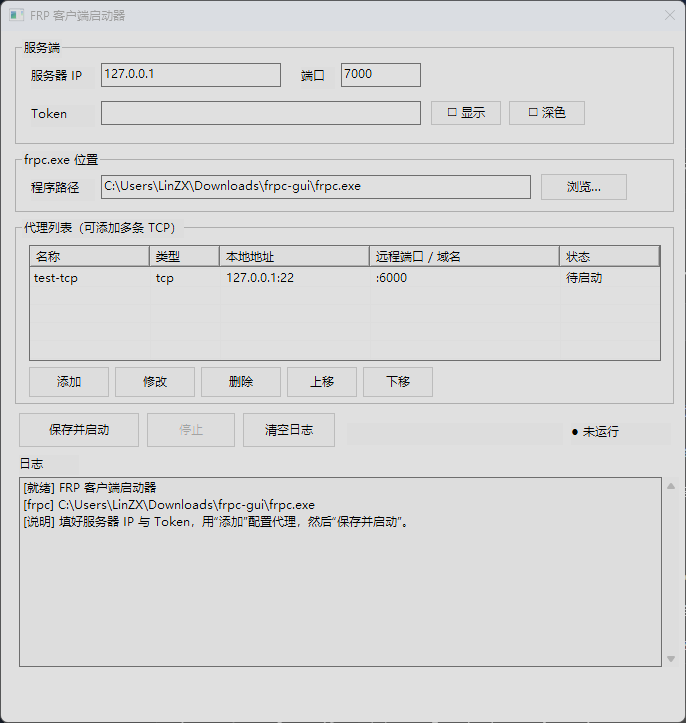
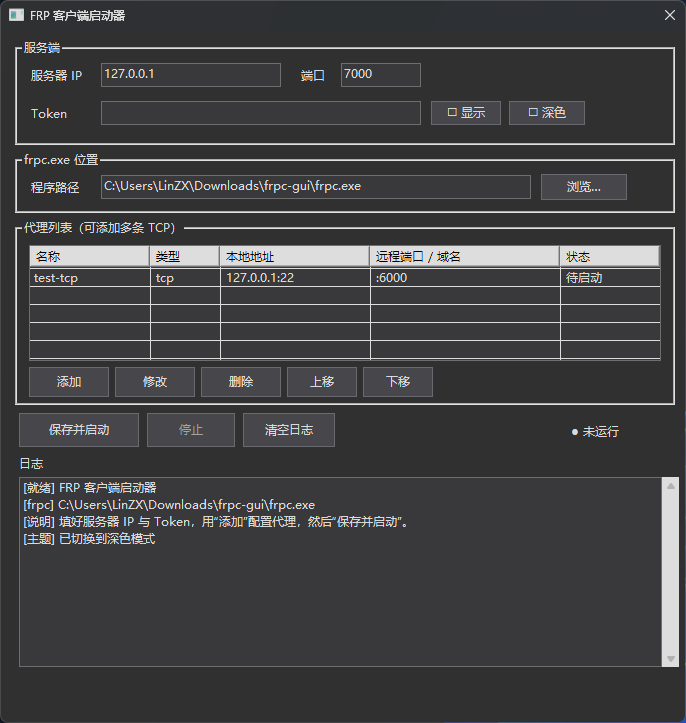
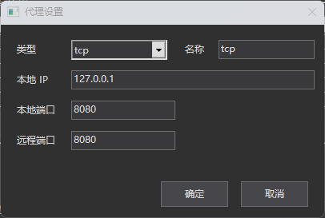
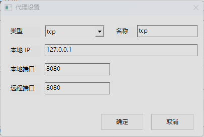

# frpc-gui

[frp](https://github.com/fatedier/frp) 客户端的图形界面启动器。填写服务器 IP 和 Token 即可启动内网穿透，支持配置多条代理，协议可选 **TCP / UDP / HTTP / HTTPS**。

> ## ⚠️ 关于「打开后瞬间闪退」
>
> **该问题已在 2026-10 修复。** 如果你使用旧版本遇到闪退，请更新到最新版。
>
> ### 原因
>
> 属于本程序自身的缺陷：调用 Win32 API 时，传给系统的 UTF-16 字符串缓冲区没有保证存活到调用结束（Go 的 GC 可能在 `Syscall` 执行期间回收它们），导致**随机访问冲突**（`0xC0000005`）。
>
> 这是一个隐蔽的 bug —— 它平时命中率很低，但当外部软件（例如带游戏内覆盖层的工具）注入进程、改变了堆布局与分配时序后，命中率会骤增，表现为「打开就闪退」。
>
> ### 修复
>
> 所有传入 Win32 的缓冲区与结构体现在都用 `runtime.KeepAlive` 固定到调用结束，并且后台线程不再直接访问 GUI 线程持有的状态。
>
> ### 验证方式
>
> 修复前后各编译一个版本，在同一时刻、同一环境下交错运行 14 轮（外部注入软件保持运行）：
>
> | 版本 | 崩溃次数 |
> | --- | --- |
> | 修复前 | **11 / 14** |
> | 修复后 | **0 / 14** |
>
> 如果你在最新版上仍然遇到闪退，请到 [Issues](https://github.com/LinZX1314/frpc-gui/issues) 反馈，并附上系统版本与复现步骤。

## 界面截图

浅色模式：



深色模式：



代理设置对话框（深色 / 浅色）：

<p>
  
  
</p>

## 特点

- 零第三方依赖 —— 纯 `syscall` 调用 Win32 API，不用任何 GUI 库
- 体积小，单文件约 2.9 MB，无控制台窗口
- **深色模式**，标题栏、控件、列表全部跟随，可随时切换
- 支持高 DPI 屏幕，125% / 150% 缩放下界面清晰不模糊
- 多代理管理：添加、修改、删除、上移、下移，重名自动补全
- 三种方式指定 frpc.exe：自动探测 / 浏览选择 / 拖拽到窗口

## 使用方法

### 1. 下载 frpc.exe

到 [frp 官方 Releases](https://github.com/fatedier/frp/releases) 下载对应平台的压缩包，解出 `frpc.exe`。

### 2. 与本程序放在同一目录

```
frpc-gui.exe      ← 本程序
frpc.exe          ← 官方 frp 客户端
frpc-gui-data/    ← 首次运行自动生成，存放配置
```

### 3. 运行

双击 `frpc-gui.exe`：

1. 填写服务器 IP、端口（默认 7000）、Token
2. 点「添加」配置代理，选择协议类型：
   - **TCP / UDP** —— 填本地端口和**远程端口**
   - **HTTP / HTTPS** —— 填本地端口和**自定义域名**（多个用逗号分隔）
3. 点「保存并启动」

配置会保存在同目录的 `frpc-gui-data/config.json`，下次打开自动回填。

> **提示**：HTTP / HTTPS 代理没有「远程端口」。HTTP 流量走服务端 `frps.toml` 里配置的 `vhostHTTPPort`（默认 80）/ `vhostHTTPSPort`（默认 443），按域名（Host）路由，所以客户端只需要填**自定义域名**，并确保域名已解析到服务器 IP。

## 功能

| 功能 | 说明 |
| --- | --- |
| 服务器设置 | IP、端口、Token，Token 可切换明文显示 |
| 协议支持 | TCP / UDP / HTTP / HTTPS，按类型自动切换填写项 |
| 代理列表 | 添加 / 修改 / 删除 / 上移 / 下移，显示类型与目标 |
| 深色模式 | 一键切换，设置自动保存 |
| frpc.exe 定位 | 自动探测、浏览选择、拖拽入窗 |
| 运行日志 | 实时显示 frpc 输出，Token 自动打码 |
| 配置持久化 | 下次启动自动回填上次的设置 |

## 常见问题

### 打开后闪退

见页面顶部的 [闪退说明](#️-关于打开后瞬间闪退)。该问题已修复，请使用最新版本。

### 启动失败，日志提示 `unknown field`

frpc 默认开启严格配置校验（strict config）。不同版本的 frp 支持的配置项不同，请确认你使用的 frpc.exe 版本与生成的配置兼容。本程序已按 frp 0.71 的配置格式生成。

### HTTP 代理启动后访问不到

检查服务端 `frps.toml` 是否配置了 `vhostHTTPPort`，以及域名是否已解析到服务器 IP。

## 构建

需要 Go 1.21 或更高版本：

```bash
go build -trimpath -ldflags "-H windowsgui -s -w" -o frpc-gui.exe .
```

- `-trimpath` 去掉二进制中的本机源码路径
- `-H windowsgui` 去掉控制台窗口
- `-s -w` 去掉符号表和调试信息

运行测试：

```bash
go test ./...
```

## AI 创作说明

本项目的代码由 **AI 编程助手**参与完成，具体情况如下：

| 环节 | 负责方 |
| --- | --- |
| 需求定义与功能取舍 | 人工 |
| 技术方案决策 | 人工 |
| 代码编写与问题排查 | AI 编程助手 |
| 文档撰写 | AI 编程助手 |
| 功能验证与最终验收 | 人工 |

代码在发布前经过实际编译、`go vet` 静态检查、单元测试，并在真实 frp 服务端做过连通性验证。

请注意：**AI 生成的代码可能存在未被发现的问题**，使用前请自行评估是否适用于你的场景，尤其是在生产环境中。

## 许可

GUI 部分暂无许可证。调用的 [frp](https://github.com/fatedier/frp) 采用 Apache-2.0 许可。
